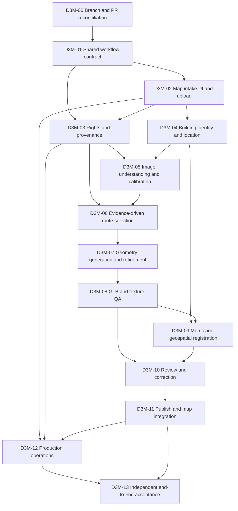

# Dynamic 3D Map — End-to-End Building Reconstruction Execution Plan

**Created:** 2026-10-30  
**Planning baseline:** `development` at `98b2fa56f387c2bdbf4dad5c24e6f131dd66d076`  
**Current integration baseline:** see [Full Repository Gap Audit](./ENGINE-FULL-REPOSITORY-GAP-AUDIT.md)  
**Parent roadmap:** [Engine Integration and Production Roadmap](./ENGINE-INTEGRATION-AND-PRODUCTION-ROADMAP.md)  
**Status:** Planned work. This document does not certify that the end-to-end workflow currently works.

---

## 1. Goal

Deliver one coherent workflow in the existing Cesium map:

1. An operator selects a building or supplies its identity and known information.
2. The operator uploads one or more rights-cleared building images, or a permitted video/capture set.
3. The platform validates and records the exact source assets.
4. The engine selects a reconstruction method that is appropriate for the available evidence.
5. A 3D building candidate is generated, checked, and presented for review.
6. Scale, orientation, horizontal position, and vertical reference are established from evidence rather than guessed.
7. A reviewer accepts or rejects the exact candidate version.
8. An approved, versioned model becomes available in the existing Dhaka map at its verified location.
9. The model and job history remain available after page refresh and deployment restart.

The intended user experience is simple. The engineering contract behind it must distinguish what was observed, measured, inferred, and left unknown.

## 2. What counts as complete

The feature is complete only when a new building can pass through the same traceable workflow from intake to map display, without a developer manually copying a GLB or typing placement values into the development preview.

A successful GLB export alone is not completion. A successful Cesium load alone is not completion. A green CI run alone is not completion.

The minimum end-to-end acceptance run must prove all of the following against the exact model and source hashes:

- source rights and permitted operations were checked;
- source files are bound to a building identity and the intended views;
- the selected reconstruction route actually executed;
- the GLB contains supported geometry and valid materials/textures;
- dimensions and scale were compared with independent evidence;
- horizontal position and vertical datum were separately checked;
- reviewer decisions refer to the exact candidate hash;
- publication creates an immutable version and a traceable placement record;
- the existing map loads the active version from the published service/catalog;
- reload, version change, failed replacement, and rollback behave correctly.

## 3. Current baseline: what exists and what remains disconnected

The status labels below describe the inspected repository baseline. They are not completion percentages.

| Area | Baseline status | Existing foundation | Remaining gap |
|---|---|---|---|
| Existing Dhaka map | Implemented foundation | Cesium map, Overture building layer, viewport loading, search, picking, and map controls | Generated-building lifecycle must be integrated into the ordinary map data flow and tested with real published assets |
| Generated GLB loader | Implemented foundation | `GeneratedModelLayer` supports load/update/show/hide/remove and geographic transforms | Placement is supplied to the layer; it is not inferred automatically |
| Procedural generation | Implemented, limited | BuildingSpec can produce parametric GLB geometry | Input images do not change procedural geometry; the result is not a photogrammetric model |
| Single-image route | Partial | TripoSR worker integration exists | External Python/model runner/compute setup; single-view output is approximate and has unknown hidden surfaces, scale, and georeference |
| Multi-view route | Partial | COLMAP worker, dense mesh/texture conversion, diagnostics, and GLB output exist | External COLMAP runtime, view coverage, camera/scale evidence, and accepted georeferencing still need a proven end-to-end run |
| Media intake/upload | Partial | Private media intake, source hashes, rights metadata, and an upload API exist | Upload UI and job submission must be connected; upload currently remains unreviewed until rights review |
| Generation queue/worker | Partial | Authenticated endpoints and a local file-backed queue/worker exist | Shared durable storage, multi-user authorization, production worker operations, and completed-job-to-map integration |
| Geometry and visual QA | Partial | GLB geometry extraction, topology/texture checks, render review, and accuracy tooling exist | One unified gate must bind fresh reports and human review to the exact candidate |
| Ground-control registration | Partial | Registration/metric validation components exist | A repeatable independently evidenced coordinate and vertical-datum workflow is not yet accepted for a real Dhaka building |
| Review/publishing | Partial | Review APIs, approved-job publisher, versioned manifest, checksum validation, and CLI publication exist | Operator-facing review and publication UX; secure persistent asset storage; no automatic map insertion after approval |
| Published catalog map UI | Implemented foundation | The map panel can fetch the static catalog and manually load an active model | It is a manual/session workflow; page refresh does not restore the in-memory model automatically |
| End-to-end user workflow | Not established | Components exist across multiple modules | A browser-tested upload → process → review → publish → map-load flow is still required |

### Important implementation facts

- The default generation route is procedural from BuildingSpec. It does not automatically interpret the supplied images.
- The photogrammetry route requires explicit source selection and review confirmations; the COLMAP worker produces a review candidate and does not claim WGS84 ground-control registration.
- The single-image route explicitly marks scale and georeference as unsolved and requires human review.
- Generation jobs deliberately retain fail-closed values such as `mapReady=false` and `publicationEligible=false`.
- The current published-model workflow is based on a static manifest plus local CLI publication. It is not yet a complete authenticated Admin publication service.
- The map loader requires explicit geographic placement metadata. Do not claim that it discovers exact coordinates or metric scale from an ordinary photograph.

## 4. Product and data contract to agree before implementation

Create one versioned contract shared by upload UI, API, worker, review, publisher, and map loader. Avoid separate loosely related JSON shapes for each phase.

### 4.1 Building record

At minimum:

- stable building ID and display name;
- selected map feature ID or independently reviewed building identity;
- source footprint and its CRS/provenance;
- address or locality where available;
- building use/type where known;
- known dimensions and their source, units, uncertainty, and evidence tier;
- horizontal coordinate frame and vertical datum state;
- status: draft, intake, processing, candidate, review-required, approved, published, rejected, or failed.

### 4.2 Source asset record

At minimum:

- stable source ID, exact byte size, SHA-256, media type, dimensions, and safe storage key;
- source/building/view linkage and capture side/viewpoint when known;
- creator/rights-holder, licence or permission record, attribution, permitted operations, expiry/territory where applicable;
- EXIF/capture time/location only where present and permitted;
- quality/occlusion/duplicate assessment;
- explicit review state: unreviewed, approved-for-specific-operations, rejected, expired, or unknown.

A hash establishes byte identity, not copyright permission or building identity.

### 4.3 Reconstruction job record

At minimum:

- job ID, building ID, immutable input manifest hash, selected strategy, configuration hash, model/tool versions;
- stage state, progress, timestamps, retries, worker identity, cancellation state, and structured failure reason;
- exact candidate GLB hash and all QA/render report hashes;
- separate confidence and evidence state for geometry, scale, horizontal position, vertical position, texture, and source rights;
- explicit readiness fields: `candidateGenerated`, `geometryValidated`, `metricValidated`, `humanReviewed`, `publicationEligible`, and `mapReady`.

Do not collapse these independent gates into one generic `completed` status.

### 4.4 Published model record

At minimum:

- stable building/model ID and immutable version ID;
- content-addressed GLB URL/storage key and SHA-256;
- longitude/latitude/height, heading/pitch/roll, model scale and axis conventions;
- horizontal CRS, vertical datum, placement evidence ID, and uncertainty;
- reviewer, timestamp, decision, evidence-package hash, and all required review checks;
- active/retired state and rollback target.

The map must consume this published record rather than accept untrusted arbitrary client URLs or unverified placement values.

## 5. Dependency-ordered execution phases

Each phase must be implemented in a focused PR with exact-head tests. A phase is not done because its files exist; close it only when its acceptance evidence is attached.

### D3M-00 — Reconcile integration branches and PR dependencies

**Priority:** P0 · **Status:** IN PROGRESS — live branch/PR inventory captured; reconciliation and clean-base ports remain open · **Dependencies:** none

**Purpose:** Establish one safe source of truth before connecting more components.

**Tasks**
- [x] Re-read current `main`, `development`, and `rakibul-hasan` SHAs (snapshot below; refresh before each write/merge).
- [x] Compare selected pipeline-critical PR base/head SHAs, changed paths, and exact-head CI; record unresolved ancestry below.
- [x] Map the currently identified map UX, BRF-05/06, generated-model-layer, 3D Tiles and floor-plan PRs to this plan.
- [x] Identify the #274/#196 duplicate overlap and the old-base #277/#278 ports by exact changed paths/patch comparison.
- [ ] Finish the `main`/`development` ancestry and content reconciliation, clean-port old-base work, and close only PRs proven redundant.
- [ ] Agree the canonical integration base for each work package; preserve the `rakibul-hasan → development → main` promotion policy where ancestry permits.
- [ ] Do not bulk-merge stale branches or force-push user work.

**Likely files:** GitHub branch/PR metadata; `docs/ENGINE-FULL-REPOSITORY-GAP-AUDIT.md`; `docs/ENGINE-INTEGRATION-AND-PRODUCTION-ROADMAP.md`.

**Acceptance**
- [ ] A dependency matrix records PR number, base, head SHA, merge base, CI state, owner, and decision.
- [ ] No unreviewed conflict or unexplained divergent commit remains in the selected path.
- [ ] The next implementation branch is based on the verified integration head.

### D3M-01 — Freeze the workflow contract and stage state machine

**Priority:** P0 · **Status:** Not established end-to-end · **Dependencies:** D3M-00

**Tasks**
- [ ] Define versioned schemas for Building, SourceAsset, GenerationJob, Candidate, ReviewDecision, PlacementEvidence, and PublishedModel.
- [ ] Define state transitions and legal transitions, including cancellation, retry, stale candidate, rejected review, superseded version, and rollback.
- [ ] Define idempotency keys for uploads, enqueue requests, worker stages, review submissions, and publication.
- [ ] Bind each stage to input/output hashes, configuration version, tool/model versions, and timestamps.
- [ ] Define explicit unknown/estimated/observed/independently-measured values; never silently fill missing dimensions or coordinates.
- [ ] Define the API contract and the boundary between public map-readable metadata and private source/review files.

**Likely files:** `src/core/building-generation/` schemas and state modules; `src/app/api/building-generation/`; generation and publication docs.

**Acceptance**
- [ ] Schema validation rejects missing IDs, invalid state transitions, stale hashes, and cross-building references.
- [ ] Contract tests cover request/response compatibility between API, worker, review, and publisher.
- [ ] Existing generation and publication flows can be migrated without weakening fail-closed flags.

### D3M-02 — Build the actual map-facing building intake experience

**Priority:** P1 · **Status:** Gap · **Dependencies:** D3M-01

**Tasks**
- [ ] Add an intake action to the existing map, attached to a selected building or an explicit “add building” workflow.
- [ ] Allow building identity/information entry and one or more image/video uploads.
- [ ] Show per-file upload progress, validation errors, rights/attribution fields, and source-view labels.
- [ ] Require the user to choose the intended building on the map or provide enough identity evidence before intake is accepted.
- [ ] Show upload completion separately from rights approval and reconstruction readiness.
- [ ] Create a generation job only after required metadata and explicit source-operation confirmations pass.
- [ ] Keep original assets private; never put unreviewed source media or private evidence under public static paths.

**Likely files:** `src/features/map/components/`; `src/app/map/page.tsx`; `src/app/api/building-generation/uploads/route.ts`; `src/app/api/building-generation/jobs/route.ts`; `src/core/building-generation/generation-media-upload.mjs`.

**Acceptance**
- [ ] Browser test uploads valid, oversized, corrupt, duplicate, and unsupported files.
- [ ] A refresh or network interruption does not create duplicate jobs or lose the upload/job association.
- [ ] Unreviewed media cannot be submitted to reconstruction.
- [ ] Keyboard, mobile viewport, and accessible error states are covered.

### D3M-03 — Complete rights-aware intake and source provenance continuity

**Priority:** P0 · **Status:** Partial · **Dependencies:** D3M-01, D3M-02

**Tasks**
- [ ] Bind exact file bytes to the rights record and source identity.
- [ ] Enforce permitted operations separately for storage, display, image quality analysis, segmentation, frame extraction, photogrammetry, single-image inference, derivative creation, review export, and publication.
- [ ] Revalidate rights when a job starts, resumes, reuses a cached output, or publishes.
- [ ] Carry source hashes and transformation provenance through video frames, masks, observations, meshes, textures, and evidence packages.
- [ ] Handle expiry, revocation, attribution duties, territory, and derivative-use restrictions.
- [ ] Keep unknown or conflicting rights blocked.

**Likely files:** `src/core/building-generation/media-intake.mjs`; `source-workflow.mjs`; `source-operation-scopes.mjs`; BRF-38/45/46 modules and tests.

**Acceptance**
- [ ] Positive and negative tests exist for every permitted operation.
- [ ] Mutated bytes, revoked permissions, expired permissions, scope mismatch, and cached-output replay are rejected.
- [ ] The evidence bundle can trace every published derivative back to the exact approved source set.

### D3M-04 — Establish building identity, map target, footprint, and location evidence

**Priority:** P0 · **Status:** Partial / external evidence required · **Dependencies:** D3M-01, D3M-02

**Tasks**
- [ ] Support selecting an existing Overture/map building and binding its stable source feature ID to the reconstruction job.
- [ ] Support a separately reviewed new-building footprint when no suitable map feature exists.
- [ ] Store the footprint CRS, source, timestamp, geometry hash, and identity-review decision.
- [ ] Distinguish a building identity match from a nearby or visually similar building.
- [ ] Accept surveyed control points or another documented independent location source.
- [ ] Define what happens when the image has no trustworthy location: ask for map selection/address/control evidence and mark location unresolved.
- [ ] Do not treat an ordinary street photograph or an EXIF coordinate as proof of the building footprint or exact facade location.

**Likely files:** `src/app/api/geospatial/overture-buildings/`; `src/core/building-generation/brf35-building-linkage.mjs`; footprint/linkage and ground-control modules.

**Acceptance**
- [ ] Wrong-building, duplicate-building, adjacent-building, and mismatched-footprint tests fail safely.
- [ ] Identity, footprint, and location provenance are separately reported.
- [ ] No exact placement is asserted without accepted coordinate evidence.

### D3M-05 — Integrate image quality, view coverage, masks, observations, and camera calibration

**Priority:** P0 · **Status:** Partial · **Dependencies:** D3M-03, D3M-04

**Tasks**
- [ ] Normalize image orientation and preserve original pixel dimensions and crop/resize transforms.
- [ ] Detect blur, clipping, near-duplicates, severe occlusion, and unusable views; record per-view decisions.
- [ ] Bind each image to front/rear/left/right/roof/corner or an explicit unknown viewpoint.
- [ ] Connect BRF-05 manual masks and BRF-06 architectural observations into one hash-bound bundle.
- [ ] Record camera intrinsics, distortion, pose, uncertainty, coordinate frame, and calibration source—or explicitly mark each unknown.
- [ ] Estimate overlap and camera coverage; distinguish “same building” confirmation from image overlap.
- [ ] Link observations such as corners, rooflines, floor bands, windows, arches, columns, and balconies to source pixels and review history.

**Likely files:** `image-quality-preflight.mjs`; `media-quality-preflight.mjs`; `building-mask-provider.mjs`; `architectural-observation-schema.mjs`; `architectural-feature-proposals.mjs`; BRF-05/06/07 work.

**Acceptance**
- [ ] Combined mask/observation export and re-import preserve source IDs, bytes, dimensions, and pixel coordinates.
- [ ] Stale source hashes, mismatched dimensions, unsupported crop transforms, and dangling observations are rejected.
- [ ] Camera calibration state and coverage uncertainty are visible to the route selector.
- [ ] A browser review test covers mask and observation correction.

### D3M-06 — Make reconstruction strategy selection evidence-driven

**Priority:** P1 · **Status:** Partial · **Dependencies:** D3M-03, D3M-05

**Tasks**
- [ ] Define an explicit route policy using number of usable views, overlap, camera calibration, rights scope, source quality, scale evidence, and compute availability.
- [ ] Route a single image to an AI-proposed preview only when the operator explicitly accepts single-view inference and its limitations.
- [ ] Route sufficient same-building overlapping views to COLMAP only after all required rights, identity, overlap, and axis checks pass.
- [ ] Use procedural BuildingSpec generation only as a clearly labelled parametric estimate or as a supported prior—not as image reconstruction.
- [ ] Refuse unsupported routes and explain the missing evidence instead of silently falling back to a misleading model.
- [ ] Record why a route was selected or blocked and which external tool/model version was used.

**Likely files:** `generation-engine.mjs`; `generation-pipeline.mjs`; `media-to-model-workflow.mjs`; `colmap-worker.mjs`; `single-image-3d-worker.mjs`.

**Acceptance**
- [ ] Tests cover one image, two images, adequate multi-view, duplicate views, wrong-building views, low overlap, missing rights, missing runtime, and unsupported formats.
- [ ] The job report distinguishes procedural, single-image AI, and photogrammetry output and never calls them equivalent evidence tiers.
- [ ] Actual worker execution is proven on at least one controlled sample for each route claimed as supported.

### D3M-07 — Produce and refine building geometry from the selected route

**Priority:** P1 · **Status:** Partial · **Dependencies:** D3M-05, D3M-06

**Tasks**
- [ ] Convert the selected route output into a documented local metric frame.
- [ ] Bind each reconstructed component/surface to supporting views or mark it inferred/unknown.
- [ ] Combine independently measured footprint/dimensions with photo-derived visible surfaces only where coordinate/calibration evidence supports the fusion.
- [ ] Integrate reviewed architectural masks/observations with the geometry workflow; corrections must change the candidate geometry, not only create review tasks.
- [ ] Preserve source meshes and every repair/correction as immutable candidate versions.
- [ ] Separate geometry creation from texture projection so texture cannot hide incorrect massing or openings.

**Likely files:** `colmap-worker.mjs`; `wireframe-to-mesh.mjs`; `multi-view-wireframe-registration.mjs`; `confidence-aware-wireframe-fusion.mjs`; `architectural-geometry-workflow.mjs`; `textured-glb-export.mjs`.

**Acceptance**
- [ ] A candidate is generated from the declared input route and exact source hashes.
- [ ] A fixed review camera set exposes all available sides and marks unsupported/occluded sides.
- [ ] Correction tests prove that a geometry correction changes the GLB hash and improves its declared metric or render comparison.
- [ ] No missing facade/roof is represented as measured truth.

### D3M-08 — Unify GLB, topology, dimension, and texture quality gates

**Priority:** P0 for publication · **Status:** Partial · **Dependencies:** D3M-07

**Tasks**
- [ ] Run actual GLB byte parsing and geometry extraction on the exact candidate file.
- [ ] Check primitive counts, vertex/triangle bounds, degenerate faces, normals, open/non-manifold boundaries, connected components, extreme edges, and invalid transforms.
- [ ] Check units, axes, bounds, footprint shape, and independent dimensions separately.
- [ ] Check material references, texture presence, UV coverage, stretch, seams, resolution, and background/occluder contamination.
- [ ] Bind geometry QA, texture QA, review renders, and correction reports to the same candidate hash.
- [ ] Define warning and hard-fail thresholds by model class; do not allow a clean container check to imply visual fidelity.

**Likely files:** `glb-geometry-extraction.mjs`; `glb-geometry-qa.mjs`; `mesh-topology-qa.mjs`; texture QA modules; release-readiness modules.

**Acceptance**
- [ ] Adversarial fixtures exist for every hard-fail condition.
- [ ] Stale or mismatched report hashes are rejected.
- [ ] Missing texture or missing geometry evidence cannot be interpreted as a pass.
- [ ] Candidate review packet includes geometry, texture, and fixed-camera visual evidence.

### D3M-09 — Establish independent metric scale and geographic registration

**Priority:** P0 · **Status:** Partial / external survey dependency · **Dependencies:** D3M-04, D3M-07, D3M-08

**Tasks**
- [ ] Define the model-local frame, units, axis order, handedness, and heading convention.
- [ ] Calibrate metric scale from independent measurements, not from the generated model itself.
- [ ] Register horizontal placement from at least three suitable non-collinear control points where the selected method requires a 2D rigid/similarity fit.
- [ ] Keep fitting controls separate from held-out check points.
- [ ] Record source CRS, target CRS, pinned coordinate-operation pipeline/version, axis order, grids, units, and transformation evidence.
- [ ] Record vertical CRS/datum separately from horizontal WGS84; distinguish ellipsoidal height, orthometric height, terrain elevation, building base, and relative roof height.
- [ ] Store residuals, uncertainty, evidence IDs, and unresolved values.
- [ ] Require map footprint overlay and independent reviewer acceptance before placement approval.

**Likely files:** `ground-control-registration.mjs`; `reference-dimension-validation.mjs`; `brf37-proj-operation-executor.mjs`; `brf35-building-linkage.mjs`; placement policy/types.

**Acceptance**
- [ ] Synthetic known-transform tests cover axis swap, wrong units, mirrored model, bad controls, outliers, and vertical-datum mismatch.
- [ ] Real building placement report binds the exact GLB hash and independent control source hashes.
- [ ] Held-out residuals are reported separately from fit residuals.
- [ ] Unknown height datum or missing independent scale blocks metric/map-ready claims.

### D3M-10 — Add an operator review and correction experience

**Priority:** P1 · **Status:** Partial · **Dependencies:** D3M-08, D3M-09

**Tasks**
- [ ] Show source images, selected views, masks/observations, candidate GLB, and fixed review renders side by side.
- [ ] Show geometry/texture QA, dimensions, control-point residuals, source rights, confidence, and unresolved warnings.
- [ ] Allow accept, reject, request-correction, and annotate decisions with reviewer identity and timestamp.
- [ ] Bind every decision to exact GLB, source-manifest, QA-report, and placement-evidence hashes.
- [ ] Invalidate approvals when the candidate, source, rights, calibration, QA, or placement changes.
- [ ] Keep operator, reviewer, administrator, and publisher permissions separate.

**Likely files:** `src/features/map/components/GeneratedModelPanel.tsx`; Admin/review components; `generation-job-review.mjs`; review API routes; evidence package modules.

**Acceptance**
- [ ] Browser tests cover approve, reject, correction, stale approval, and unauthorized user paths.
- [ ] The reviewer cannot approve a different GLB than the one shown.
- [ ] Approval history is immutable and auditable.

### D3M-11 — Publish approved versions and integrate automatic map loading

**Priority:** P1 · **Status:** Partial · **Dependencies:** D3M-09, D3M-10

**Tasks**
- [ ] Replace local-only publication assumptions with a server-side publisher authorized by the role model.
- [ ] Store immutable GLB bytes in private/object storage until approval; expose only approved map assets through authorized or intentionally public delivery.
- [ ] Publish model metadata and placement as one atomic versioned record.
- [ ] Make map initialization or a generated-model catalog service discover active models for the current viewport.
- [ ] Load only models intersecting the viewport/selected area; avoid loading every published GLB globally.
- [ ] Restore active models after page reload and reconcile visibility/version changes.
- [ ] Add version rollback, asset retirement, cache invalidation, and integrity checks.
- [ ] Keep manual preview as a development-only path, visibly separate from production publishing.

**Likely files:** `published-model-catalog.mjs`; `published-model-catalog-reader.mjs`; `publish-approved-generation-job.mjs`; `generated-model-layer.ts`; `GeneratedModelPanel.tsx`; `MapCanvas.tsx`; `map-engine.ts`.

**Acceptance**
- [ ] A fully approved job is published without manual file copying or editing a public manifest.
- [ ] The map loads the published model using verified placement metadata.
- [ ] A hard refresh restores the active model; a retired/rolled-back version is not loaded.
- [ ] Wrong hashes, invalid placement, unauthorized publication, duplicate model IDs, and failed asset fetches fail safely.
- [ ] Existing Overture buildings, roads, map selection, and viewport performance do not regress.

### D3M-12 — Make the workflow production-safe and operable

**Priority:** P0 before production · **Status:** Partial · **Dependencies:** D3M-02, D3M-03, D3M-11

**Tasks**
- [ ] Replace local-only job/result assumptions with durable database state and private shared object storage.
- [ ] Define authentication, RBAC, project/building isolation, token rotation, rate limits, quotas, and audit identity.
- [ ] Add worker leases, concurrency control, heartbeat, retries, dead-letter handling, cancellation, and safe restart/recovery.
- [ ] Scan/validate uploads, enforce per-media size limits, isolate parsers/processes, and restrict outbound/network access.
- [ ] Define retention, user deletion, backup/restore, encryption, monitoring, alerting, and operational runbooks.
- [ ] Measure job latency/resource consumption and map model-load latency separately.
- [ ] Prevent private inputs, review images, tokens, and internal paths from appearing in public responses/logs.

**Likely files:** generation API/auth/queue/worker modules; storage adapter; deployment configuration; operational tests and docs.

**Acceptance**
- [ ] Multi-user authorization and cross-project isolation tests pass.
- [ ] Concurrent worker, process crash, retry, cancellation, and recovery tests pass.
- [ ] Backup/restore and deletion workflows are demonstrated.
- [ ] Upload/parser security, quota, and retention checks are documented and tested.
- [ ] Operational dashboards/runbooks report queue depth, stage failures, worker health, storage, and map loading.

### D3M-13 — Prove the complete workflow with independent buildings

**Priority:** P0 release gate · **Status:** Not established · **Dependencies:** D3M-00 through D3M-12

**Tasks**
- [ ] Select a bounded validation set containing an ordinary residential/commercial building, an irregular building, and a complex landmark; verify rights and identity first.
- [ ] Obtain independent dimensions, horizontal controls, vertical datum, and held-out checkpoints.
- [ ] Run the entire browser-to-worker-to-review-to-publish-to-map flow on exact pinned commits.
- [ ] Capture source images, input hashes, worker logs, candidate GLB hashes, review renders, QA reports, placement residuals, reviewer decisions, published version IDs, and browser screenshots.
- [ ] Test single-image preview and multi-view reconstruction as separate evidence tiers.
- [ ] Test missing data, bad images, wrong-building match, low overlap, insufficient controls, failed workers, unauthorized review/publish, stale hashes, rollback, page reload, and viewport changes.
- [ ] Report success/failure per building and per metric; record all unknown and occluded surfaces.
- [ ] Run cold/warm map-load and multi-building viewport checks on documented browser/device/network conditions.

**Acceptance**
- [ ] At least three independent buildings have complete, rights-cleared, hash-bound evidence; any unavailable external survey/rights data remains explicitly blocked.
- [ ] Each building has separate geometry, dimension, texture, horizontal placement, vertical reference, and human visual-review outcomes.
- [ ] Held-out checkpoints are not used for fitting or correction.
- [ ] The same approved model version loads in the map after refresh and can be rolled back.
- [ ] Exact-head CI, API tests, browser tests, and relevant specialized workflows pass.
- [ ] No universal 90% accuracy claim is made unless a preregistered metric, independent holdout set, uncertainty, and sample size support it.

## 6. Dependency graph

## 7. Existing test commands to reuse

Run only the suites relevant to the changed work package, then the complete required CI matrix for the exact PR head. These commands are present in the inspected package scripts at the planning baseline; re-check current package scripts before execution.

| Area | Existing command(s) |
|---|---|
| BuildingSpec/procedural generator | `npm run test:building-generation` |
| Media intake and pipeline | `npm run test:building-media`; `npm run test:media-to-model-workflow` |
| Single-image route | `npm run test:single-image-3d` |
| COLMAP route | `npm run test:colmap-worker` |
| Queue and worker | `npm run test:generation-queue` |
| Upload/API | `npm run test:generation-media-upload` |
| Review API | `npm run test:generation-review` |
| GLB geometry/topology | `npm run test:glb-geometry-qa` |
| Metric and dimension evidence | `npm run test:reference-dimension-validation`; `npm run test:building-accuracy-benchmark` |
| Release-readiness evidence | `npm run test:building-release-readiness` |
| Generated model policy/layer | `npm run test:generated-model-policy`; `npm run test:generated-model-layer-boundary` |
| Published catalog/publisher | `npm run test:published-model-catalog`; `npm run test:publish-approved-generation-job` |
| Map browser integration | `npm run test:map-browser` |
| Build quality | `npm run lint`; `npm run build` |

Add new tests where the current suites stop at module boundaries. In particular, add one Playwright test that drives a real test upload through job status, review, publication, map load, page reload, and rollback using deterministic local fixtures.

## 8. Release gates that must remain false until independently satisfied

Do not enable any of these merely because a worker returned exit code zero or a GLB file exists:

- `rightsApproved`
- `sourceIdentityVerified`
- `geometryValidated`
- `metricValidated`
- `horizontalGeoreferenceVerified`
- `verticalDatumVerified`
- `humanReviewed`
- `acceptanceEligible`
- `publicationEligible`
- `mapReady`
- `automaticApproval`

A human attestation must refer to the exact candidate and evidence hashes. The attestation mechanism verifies recorded fields and file hashes; it does not independently authenticate the reviewer, rights grant, survey, or architectural truth.

## 9. Execution board and update protocol

The first implementation task is **D3M-00**. Do not jump to later phases while branch dependencies or source evidence are unresolved.

For every completed D3M task, update this board and record:

- exact D3M ID, branch, base SHA, head SHA, and PR;
- changed files and API/schema version impact;
- exact test commands and workflow run URLs on the head SHA;
- candidate/source/evidence hashes where relevant;
- pass/fail/blocked result and unresolved external dependency;
- impact on each fail-closed release flag;
- exactly one next task.

Status meanings:

- **PLANNED:** not started.
- **IN PROGRESS:** implementation underway on a focused branch/PR.
- **IMPLEMENTED:** code exists but required evidence may still be pending.
- **VERIFIED:** exact tests/evidence pass for the declared scope.
- **BLOCKED:** external evidence, rights, survey, credentials, or infrastructure is missing.
- **ACCEPTED:** required technical and human acceptance gates have passed.

Never upgrade a task to VERIFIED or ACCEPTED from code presence, documentation, a synthetic fixture, or an unrelated green CI run.

---

## 10. D3M-00 live execution log — 2026-10-30

**Status:** IN PROGRESS. The repository snapshot and a first critical-PR dependency map are recorded. Branch divergence is not reconciled, old-base BRF work has not yet been ported, and no PR has been merged or closed.

### 10.1 Exact branch baseline

| Ref | Exact SHA observed | Finding |
|---|---|---|
| \`main\` | \`7d90b76dadaf9eebd91b9aeb13cf12dcefb5086b\` | Default branch |
| \`development\` | \`98b2fa56f387c2bdbf4dad5c24e6f131dd66d076\` | Current integration candidate |
| \`rakibul-hasan\` | \`01fc0caf4f08b1aa1dc8c1fdced1667c8d7fcb91\` | Stale relative to development |
| \`docs/full-repository-gap-audit-20261030\` | \`3a77866039c575bf01b782e479618ba4fde86d8c\` before this log update | Documentation-only continuation branch |

The branch inventory was paged to completion and returned 244 branch names. The counts below are point-in-time Git ancestry counts, not file-equivalence claims:

- \`development\` compared with \`main\`: **86 ahead / 4 behind**, diverged, merge base \`e4fd7ddfedd4fbd2faa6cdd185deeddc81dbce1c\`.
- \`rakibul-hasan\` compared with \`development\`: **10 ahead / 89 behind**, diverged. Its ten unique commits include floor-plan raster-trace work and BRF-05–07 evidence work; the old branch history must not be merged wholesale.
- The four commits reachable only from the inspected \`main\` head include a documentation status change, an earlier development-promotion preparation, the previous release merge, and PR #205's BRF-05–07 integration. These are ancestry/content reconciliation items, not automatic merge instructions.

### 10.2 Pipeline-critical PR decision matrix

CI states below are GitHub Actions results observed for the exact listed head at audit time. A green run proves only its declared test matrix on that commit; it does not replace source-rights, survey, visual, reviewer, or deployment acceptance.

| PR | Base → head (short SHA) | Exact-head CI / evidence observed | D3M decision |
|---|---|---|---|
| [#228](https://github.com/RakibulhasanUtsho07/3d-geospatial-platform/pull/228) | \`main@7d90b76\` → \`development@98b2fa5\` | CI #2282 and BRF-05–07 #187 passed on development SHA \`98b2fa5\` | HOLD release promotion. Resolve the 4 main-only ancestry/content commits and obtain review on the exact merge candidate before promotion. |
| [#279](https://github.com/RakibulhasanUtsho07/3d-geospatial-platform/pull/279) | \`development@98b2fa5\` → \`docs/...@3a77866\` | CI #2508 was in progress when checked | Keep Draft; documentation-only. This log is added on this branch; re-check exact-head CI after the new commit. |
| [#274](https://github.com/RakibulhasanUtsho07/3d-geospatial-platform/pull/274) | \`development@98b2fa5\` → \`feat/p3-4-map-ux-imagery-diagnostics-dev-20261029@439e5c8\` | CI #2285 and Real-Dhaka Browser Baseline #45 passed on exact head | Canonical map-UX candidate for review. Keep Draft/unmerged until human diff and screenshot/evidence review. |
| [#196](https://github.com/RakibulhasanUtsho07/3d-geospatial-platform/pull/196) | \`development@98b2fa5\` → \`fix/map-viewport-ux-current-base-20261026@f307d57\` | CI #1855 passed on exact head | Duplicate/superseded candidate: 23 paths overlap #274; 21 common file patches are byte-identical, and the two remaining differences are package/workflow placement/order. #274 additionally contains the real-Dhaka baseline workflow. Do not close #196 until #274 is reviewed and its unique value is confirmed. |
| [#277](https://github.com/RakibulhasanUtsho07/3d-geospatial-platform/pull/277) | \`rakibul-hasan@01fc0caf\` → \`feat/brf05-07-manual-mask-review@df684a4\` | CI #2495 passed on exact head | Do not merge this old-base branch. Clean-port only its mask-editor/report/browser-test delta onto a branch created from the current development head, then rerun focused and full CI. |
| [#278](https://github.com/RakibulhasanUtsho07/3d-geospatial-platform/pull/278) | \`rakibul-hasan@01fc0caf\` → \`feat/brf06-architectural-observation-review-studio@22be966\` | CI #2503 passed on exact head | Do not merge this old-base branch. Port separately after the mask-editor work; reconcile its observation-schema change and shared BRF report update against the new development head. |
| [#275](https://github.com/RakibulhasanUtsho07/3d-geospatial-platform/pull/275) | \`development@98b2fa5\` → \`feat/p3-6-multibuilding-tiles-package@36a2e5f\` | CI #2501 and P3.6 package workflow #188 passed on exact head | Keep Draft for review. This validates a bounded footprint-extrusion/tiles path; synthetic 8 m heights and footprint baselines are not image-derived facade reconstruction or independent survey truth. |
| [#276](https://github.com/RakibulhasanUtsho07/3d-geospatial-platform/pull/276) | \`development@98b2fa5\` → \`feat/p3-7-floor-plan-vector-calibration@0e907de\` | CI #2424 and P3.7 workflow #20 passed on exact head | Keep as a separate interior/floor-plan workstream; it is not a prerequisite for the first exterior-building map workflow. |
| [#193](https://github.com/RakibulhasanUtsho07/3d-geospatial-platform/pull/193) | old \`rakibul-hasan\` base \`fa08cb5\` → \`integration/generated-model-layer-current-head@ddcbc33\` | No new exact-head CI was relied on in this audit | Likely functionally superseded on development: \`generated-model-layer.ts\` has the exact same blob SHA \`40f79953cf2202dab79200134643432232920ab3\`, and current \`cesium-adapter.ts\` already instantiates the layer and delegates add/update/remove. Do not close until the remaining PR-specific diff/docs/tests are checked. |

### 10.3 Concrete reconciliation conclusions

1. **Do not merge #228 yet.** The PR is open and mergeable according to GitHub metadata, but it promotes 86 commits across 204 files and the base has four commits not reachable from development. A clean mergeability signal does not explain these historical/content differences. Review the merge-base delta and run acceptance checks on the final candidate.
2. **Use #274 as the map-UX review candidate; hold #196 as a duplicate.** Patch-level comparison found 21 exact common patches out of 23 shared files; #274's extra baseline workflow makes it the stronger candidate. Do not close either PR before reviewing #274's current diff/evidence.
3. **Port #277 and #278 from the current development base.** Both source PRs target the old \`rakibul-hasan\` head, and development is 89 commits ahead of that base. The PR-specific changes are small enough to port selectively; preserve each original PR as evidence until its replacement is validated. #277 and #278 both update the same BRF report, so port them sequentially rather than in parallel.
4. **Keep #275 and #276 isolated.** Their exact-head CI is green, but their acceptance scope is distinct; tile footprint/placement checks must not be described as photo-to-3D reconstruction or survey accuracy, and floor-plan calibration is a separate interior workflow.
5. **Do not re-port #193 blindly.** The generated model layer file is byte-identical on development and its Cesium adapter already delegates the public lifecycle methods. Finish reviewing PR-only doc/test changes before deciding it is fully superseded.
6. **No branch refs, code, release flags, or PR states were changed by this audit.** No application tests were run locally in this documentation pass; CI states above are remote GitHub workflow records.

### 10.4 D3M-00 checklist status

- [x] Read exact branch heads for main, development, rakibul-hasan, and the docs continuation branch.
- [x] Enumerate the repository branch names (244 returned across paged results).
- [x] Inspect the principal map UX, BRF-05/06, 3D Tiles, floor-plan, generated-model-layer, docs, and release PR metadata.
- [x] Compare #274/#196 at patch level and identify duplicate ownership.
- [x] Compare old-base BRF branches with development and identify why whole-branch merges are unsafe.
- [ ] Reconcile the four main-only commits and final #228 merge candidate.
- [x] Clean-port #277 onto a new clean-base branch (#280); exact-head CI #2513 passed. Human review/acceptance remains pending.
- [x] Clean-port #278 sequentially into the combined candidate (#281), stacked on #280. Current head has expanded unit coverage; exact-head CI #2530 is still running. Human review/acceptance remains pending.
- [ ] Review #274 and decide whether #196 can be closed as duplicate.
- [ ] Finish #193 PR-only diff review before marking superseded.
- [ ] Re-check all critical PRs, review threads, and CI after each branch changes; do not mark D3M-00 complete until the selected integration path has no unresolved ancestry or duplicate ownership.

### 10.5 Next task — exact continuation pointer

**Continue from the canonical combined PR #281**, not from the original #277/#278 branch histories or duplicate PR #282.

1. Check CI #2530 for exact head `04b62ceb910b6c63986703ec1587846a1676bc85` and fix any failure.
2. Keep #281 Draft until human review. It contains the #280 mask-editor parent plus #278 observation-review work; do not merge #280 independently.
3. After the combined BRF candidate is reviewed and merged, continue the remaining D3M-00 items in Section 10.9.
### 10.6 D3M-00.B — BRF-05 manual mask editor clean-base port (2026-10-30)

**Implementation status: VERIFIED by exact-head CI; human review and acceptance pending.**

- **Source:** old-base PR [#277](https://github.com/RakibulhasanUtsho07/3d-geospatial-platform/pull/277), base `rakibul-hasan@01fc0caf`, source head `df684a4d36f36133609839bfa2b751d25205b924`.
- **Clean branch:** `feat/brf05-07-manual-mask-review-dev-20261030`; exact parent `development@98b2fa56f387c2bdbf4dad5c24e6f131dd66d076`; branch head `09a52828e78f853c3a19a8f60c5bd32b3ccc73fd`.
- **PR:** [#280](https://github.com/RakibulhasanUtsho07/3d-geospatial-platform/pull/280), Draft/open, mergeable at last check, no review submissions. Four paths, 428 additions, zero deletions.
- **Port paths:** `public/experimental/building-mask-review.html`, `public/experimental/building-mask-review.js`, `tests/browser/building-mask-review.spec.ts`, and the additive BRF-05–07 evidence-report section.
- **Port strategy:** selected source files and additive documentation only; no cherry-pick of the stale six-commit history; no API/schema/package-script/workflow changes.
- **Contract review:** output `result` matches the existing `building-mask-provider-v1` contract: source ID/hash, provider identity/version/config hash, mask digest/bytes/dimensions/encoding/pixel convention and assessment status/confidence/reviewer.
- **Exact-head CI:** [CI #2513 / run 40997949731](https://github.com/RakibulhasanUtsho07/3d-geospatial-platform/actions/runs/40997949731) completed successfully on head `09a52828e78f853c3a19a8f60c5bd32b3ccc73fd`. All job steps succeeded, including lint, unit/contract suites, production build, Chromium installation, production-server viewport API/browser integration and evidence uploads.
- **Acceptance boundary:** CI does not verify real mask visual quality, reviewer identity, source rights, building identity or metric/survey truth. All release flags remain false.
- **Disposition:** #280 is retained as the verified parent commit of the combined PR #281. Do not merge #280 independently because #281 contains the full parent history and the BRF-06 extension.

### 10.7 D3M-00.C — canonical BRF-06 clean-base port (2026-10-30)

**Status: IMPLEMENTED; first exact-head CI passed, updated exact-head CI in progress; human review pending.**

- **Original source PR:** [#278](https://github.com/RakibulhasanUtsho07/3d-geospatial-platform/pull/278), old base `rakibul-hasan`; its history was not cherry-picked.
- **Canonical integration PR:** [#281](https://github.com/RakibulhasanUtsho07/3d-geospatial-platform/pull/281), branch `feat/brf06-observation-review-dev-20261030`, open Draft, target `development@98b2fa56f387c2bdbf4dad5c24e6f131dd66d076`.
- **Canonical head:** `04b62ceb910b6c63986703ec1587846a1676bc85`; branch compare reports 11 commits ahead, 0 behind, 9 changed paths relative to development. The nine paths combine four BRF-05 mask-editor paths from #280 and six BRF-06/report/test paths (the report is shared).
- **Parent dependency:** #281 descends from #280 exact head `09a52828e78f853c3a19a8f60c5bd32b3ccc73fd`. #280 exact-head CI #2513 / [run 40997949731](https://github.com/RakibulhasanUtsho07/3d-geospatial-platform/actions/runs/40997949731) succeeded, including browser/API integration.
- **Canonical exact-head CI:** first full run #2519 / [run 40998801920](https://github.com/RakibulhasanUtsho07/3d-geospatial-platform/actions/runs/40998801920) succeeded on an earlier head. A subsequent unit-test round-trip regression update produced current head `04b62ceb910b6c63986703ec1587846a1676bc85`; updated CI #2530 / [run 41000920752](https://github.com/RakibulhasanUtsho07/3d-geospatial-platform/actions/runs/41000920752) is **in progress**. Do not reuse the earlier success as proof for the new head.
- **Duplicate port:** [PR #282](https://github.com/RakibulhasanUtsho07/3d-geospatial-platform/pull/282) was closed on 2026-10-30 after discovering #281 already contained the same six BRF-06 paths plus the #280 prerequisite. Its duplicate branch must not be merged. Keep #281 as the only canonical integration candidate.
- **Implementation:** local-only source-bound observation studio; Point/LineString/BoundingBox/Polygon source-pixel annotations; explicit visibility states; review/reject/reopen with original proposal and append-only review history; M07 normalizer validates and preserves provenance/history; unit and browser regressions cover lifecycle, import/export, null-geometry visibility and tamper cases.
- **Remaining integration gap:** observation studio still exports `mask: null`; it is not yet linked to the #280 mask editor. D3M-01/WP-01 must define a shared bundle contract binding both artifacts to identical source ID/hash/dimensions and exact mask SHA-256, with cross-artifact tests.
- **Safety boundary:** reviewer identifiers are operator-supplied, not independently authenticated. No rights, physical identity, camera calibration, metric dimensions or survey truth are established. `groundTruth`, `publicationEligible`, `publishable`, `acceptanceEligible`, `mapReady`, and `automaticApproval` remain false.
- **Merge policy:** #281 is the combined 9-path candidate; do not merge #280 independently and then also merge the same cumulative changes. Keep both Draft until #281 current-head CI #2530 and human review are complete. If accepted, merge #281 once; close #280 as subsumed. Do not merge old-base #278.
### 10.8 Duplicate PR reconciliation

- PR [#282](https://github.com/RakibulhasanUtsho07/3d-geospatial-platform/pull/282) was created during a second pass but was proven redundant: its observation HTML/JS/schema/browser files matched #281 by SHA; it carried the same six-path BRF-06 delta and the same #280 parent. #281's shared report and branch log were more complete.
- The one test-file difference was reconciled by copying the fuller source unit-test file into #281, adding the rejected-review round-trip assertions. #281's current head is now `04b62ceb910b6c63986703ec1587846a1676bc85`, with CI #2530 running.
- PR #282 was closed as duplicate (not merged) with a comment linking to canonical PR #281. No source code is lost; canonical #281 now contains the fuller test file.

### 10.9 Current continuation pointer

1. Check CI #2530 / run `41000920752` on exact head `04b62ceb910b6c63986703ec1587846a1676bc85`; fix any failure and record a new exact head/run.
2. Keep canonical PR #281 Draft until updated full CI and human review are complete. Treat #282 as closed duplicate; do not reopen or merge it.
3. Resolve the combined #281/#280 merge decision exactly once. If #281 is accepted as the cumulative nine-path candidate, merge #281 once and close #280 as subsumed; never merge both cumulative branches.
4. Then continue D3M-00 remaining ancestry/duplicate work (#274/#196, #193, and main-only commit reconciliation for #228).
5. Only after D3M-00 is complete begin D3M-01: define and test the shared mask + architectural-observation evidence bundle before connecting either to automatic reconstruction.

**Live CI checkpoint (2026-10-30 10:11 +06):** updated run #2530 is still `in_progress` on exact head `04b62ceb910b6c63986703ec1587846a1676bc85`. All unit/contract test steps—including `Test evidence-linked architectural observation schema and review history`, `Test bounded per-view feature proposals and reviewed comparison`, and `Test integrated BRF-05–07 visual evidence package and fail-closed real-world gates`—have completed successfully. Chromium installation and production build have also succeeded. `Verify viewport API against the production server` remains in progress; evidence-upload steps are pending. Therefore full CI is **not yet complete** and PR #281 remains Draft.

### 10.10 D3M-00.C exact-head CI completion — 2026-10-30

**Status: exact-head CI PASS; PR review and merge decision still pending.**

- Canonical PR: [#281](https://github.com/RakibulhasanUtsho07/3d-geospatial-platform/pull/281), exact head `04b62ceb910b6c63986703ec1587846a1676bc85`, base `development@98b2fa56f387c2bdbf4dad5c24e6f131dd66d076`.
- Exact-head CI #2530 / [run 41000920752](https://github.com/RakibulhasanUtsho07/3d-geospatial-platform/actions/runs/41000920752) completed with conclusion **success** on this exact SHA. The single workflow job `Lint and production build` completed successfully.
- Verified completed steps include ESLint; all unit/contract suites (including architectural observation schema/history, per-view proposals/comparison, integrated BRF-05–07 fail-closed evidence package); production build; Chromium installation; production-server viewport API/browser integration; and uploads of P2.3, P2.4, P2.5 and P2.6 evidence/diagnostics. Every step in the job reports `completed/success`.
- This closes the CI checkpoint only. PR #281 remains **open, Draft, unmerged**; human review is still required. #280 remains the parent prerequisite and must not be merged independently if #281 is accepted as the cumulative candidate. #282 remains closed duplicate; old-base #278 is not mergeable evidence.
- No release gate is enabled: `groundTruth`, `acceptanceEligible`, `publicationEligible`, `publishable`, `mapReady`, and `automaticApproval` remain false.
- **Next:** complete D3M-00 ancestry/duplicate reconciliation (#274/#196, #193, #228) while awaiting human review on #281. Then D3M-01/WP-01 must specify and test one source-bound evidence bundle linking mask and architectural observations; the observation editor currently emits `mask: null`. Do not begin automatic reconstruction or assert real-building accuracy from these manual annotations.

### 10.11 D3M-00 viewport and map-engine branch reconciliation — 2026-10-30

**P3.4 canonical candidate:** [PR #274](https://github.com/RakibulhasanUtsho07/3d-geospatial-platform/pull/274), branch `feat/p3-4-map-ux-imagery-diagnostics-dev-20261029`, exact head `439e5c8ee26f263471b060a35296d681e0add182`, base development `98b2fa56f387c2bdbf4dad5c24e6f131dd66d076`. It is a clean 3-commit/24-path port, not stale-branch history.

- Exact-head CI #2285 / [run 40747778627](https://github.com/RakibulhasanUtsho07/3d-geospatial-platform/actions/runs/40747778627) succeeded. Real-Dhaka Browser Baseline #45 / [run 40747778776](https://github.com/RakibulhasanUtsho07/3d-geospatial-platform/actions/runs/40747778776) succeeded. All 11 workflows returned for the exact head completed successfully, including BRF-05–07, BRF-14, BRF-29, BRF-35–38, BRF-45 and BRF-46.
- PR #274 remains Draft/open/unmerged pending human visual review of its six-sample real-Dhaka evidence. Red-pixel/tile-error metrics are diagnostic signals, not proof of cause or proof the anomaly is fixed.
- Duplicate [PR #196](https://github.com/RakibulhasanUtsho07/3d-geospatial-platform/pull/196) was closed without merge as superseded. Its 23 changed paths' implementation patches match #274; #274 additionally adds `.github/workflows/real-dhaka-baseline.yml` and is based on current development. Do not reopen/merge #196.
- Old-base [PR #193](https://github.com/RakibulhasanUtsho07/3d-geospatial-platform/pull/193) was closed without merge after confirming the generated-model layer implementation, adapter delegation and boundary test are already byte-identical on development; the CI step and package test script are also present there. Its architecture note was preserved as `docs/MAP-ENGINE-MODULARIZATION.md` on this documentation branch. No code was dropped.
- Main promotion PR [#228](https://github.com/RakibulhasanUtsho07/3d-geospatial-platform/pull/228) remains open and unmerged. Current compare: development `98b2fa56f387c2bdbf4dad5c24e6f131dd66d076` is 86 commits ahead and 4 commits behind main `7d90b76dadaf9eebd91b9aeb13cf12dcefb5086b` (diverged; merge base `e4fd7ddfedd4fbd2faa6cdd185deeddc81dbce1c`, 204 changed paths). Development CI #2282 passed, but that does not resolve the four main-only commits. Do not merge #228 or promote to main until those four commits are individually inspected and the combined tree is revalidated.
- D3M-00 remains in progress: remaining release-ancestry task is inspect the four main-only commits and confirm whether any are required fixes/security/release metadata; then reconcile safely without blind merge. PR #281 remains Draft pending human review; PR #274 remains Draft pending visual review. D3M-01 still requires the shared mask+observation bundle contract. All release gates remain false.

### Main ancestry check — 2026-10-30

A direct compare of main `7d90b76dadaf9eebd91b9aeb13cf12dcefb5086b` against its exact merge-base `e4fd7ddfedd4fbd2faa6cdd185deeddc81dbce1c` reports 4 commits ahead, 0 behind, but **zero changed paths**. Thus the four main-only ancestry commits introduce no net tree difference relative to the merge base; the 204-path delta in PR #228 is the development-side work. Do not cherry-pick those four commits or describe them as missing code. Keep PR #228 unmerged until exact-head promotion CI/review is checked and the current development tree is intentionally approved for main. This resolves the content-loss concern, not the release authorization.

### 10.12 D3M-01.A — shared mask + observation evidence bundle (2026-10-30)

**Status: IMPLEMENTED ON PR #281; exact-head CI pending. Not yet merged or accepted.**

- Added `src/core/building-generation/source-bound-visual-evidence-bundle.mjs`. It hashes actual source bytes, mask PNG bytes, mask-manifest bytes and observation-export bytes; checks decoded source/mask dimensions supplied by the decoder; requires exact source ID/SHA-256/dimensions across artifacts; checks mask encoding/size/hash; rejects conflicting observation mask hashes; normalizes the observation batch and inserts the exact mask SHA-256 into its batch-level mask reference.
- Added local browser wizard `/experimental/source-bound-evidence-bundle.html` + `.js`. User selects original source image, mask PNG, mask-review JSON and observation JSON. Browser hashes all bytes, decodes both images, verifies binary white-foreground mask pixels and emits a single manifest with the normalized observation batch. The files are not uploaded; original source/mask/manifest/export files must be retained alongside the bundle.
- Added core regression tests for valid linkage, source-byte tampering, mask-byte tampering, decoded dimension mismatch, source mismatch, conflicting mask references, per-observation mask hash mismatch, release-gate tampering, review-state consistency and malformed/missing files. Added local-wizard static contract tests and a Chromium end-to-end browser spec that creates source/mask fixtures, exports observations from the existing editor, builds the bundle and rejects a mask-byte mismatch.
- Registered `test:source-bound-visual-evidence-bundle` in `package.json` and added it to `.github/workflows/ci.yml`; browser spec is picked up by the Playwright browser suite.
- Canonical implementation remains on [PR #281](https://github.com/RakibulhasanUtsho07/3d-geospatial-platform/pull/281), branch `feat/brf06-observation-review-dev-20261030`, exact head `ee76e33135174b67fac35c2f75e4c6c38ebaaf11`. Compare to development: 22 commits ahead, 0 behind, 17 changed paths. Exact-head CI #2557 / [run 41002994374](https://github.com/RakibulhasanUtsho07/3d-geospatial-platform/actions/runs/41002994374) is pending at this checkpoint; do not claim test success until it completes.
- **Acceptance boundary:** this joins artifacts by exact bytes and provenance; it does not validate semantic mask correctness, independently authenticate reviewers, grant rights, establish building identity, calibrate a camera, provide surveyed dimensions or prove model accuracy. Bundle and all release flags remain false. The observation editor still exports its standalone original with `mask: null`; the new wizard creates a separate normalized batch with the exact mask reference rather than mutating the source export.
- **Next:** poll exact-head CI #2557. If it passes, inspect the browser artifact and add any needed regression fixes. Then extend the bundle contract to bind rights/camera/ground-control evidence only when those inputs exist; never synthesize missing evidence or turn this bundle into automatic publication.

**D3M-01.A validation hardening checkpoint (2026-10-30):** browser bundle wizard now also validates observation IDs/categories/methods/status/visibility/confidence, geometry bounds, original-proposal source/view provenance and append-only review-history consistency before emitting the bundle. Static UI contract test covers the validation entry point. Latest PR #281 head is `598b2eb3e54d0e15fa2e9113910ab8ea546001b7` (17 paths, 1,633 additions vs development); exact-head CI #2563 / [run 41003170124](https://github.com/RakibulhasanUtsho07/3d-geospatial-platform/actions/runs/41003170124) is pending. Earlier run #2557 was started on an earlier head and must not be used as validation for this SHA.

**Latest exact-head checkpoint (2026-10-30):** browser end-to-end fixture was corrected to use a valid but hash-mismatched binary mask, and the wizard now validates observation batch ID/timestamp as well. Canonical PR #281 head is now `db3603b7f9280ba7e8aa9139c0dc9669d57295c5`, 17 changed paths / 1,635 additions against development. Exact-head CI #2569 / [run 41003359778](https://github.com/RakibulhasanUtsho07/3d-geospatial-platform/actions/runs/41003359778) is pending; earlier run #2563 was cancelled after the head changed and cannot validate this SHA.
