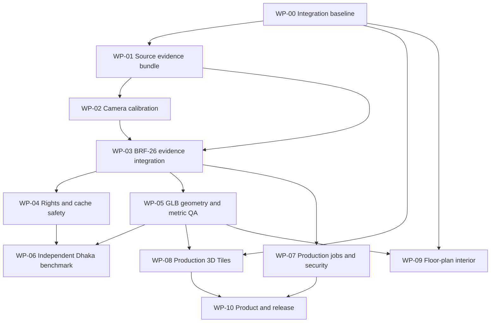

# Engine Integration and Production Roadmap

**Created:** 2026-10-30  
**Baseline:** `development` at `98b2fa56f387c2bdbf4dad5c24e6f131dd66d076`  
**Companion audit:** [Full Repository Gap Audit](./ENGINE-FULL-REPOSITORY-GAP-AUDIT.md)

This roadmap converts the repository audit into dependency-ordered work packages. It is an execution plan, not a claim that the work is complete. Update each item only with exact commit, tests, evidence, and remaining limitations.

For the specific user-facing journey — building information/images → candidate 3D model → independent metric/geospatial validation → approval → automatic loading in the Dhaka map — follow the more granular [Dynamic 3D Map End-to-End Execution Plan](./DYNAMIC-3D-MAP-END-TO-END-EXECUTION-PLAN.md). Its D3M-00 through D3M-13 tasks are the execution checklist for that product workflow; this document remains the cross-project dependency roadmap.

## Execution rules

1. Work in isolated, reviewable PRs. Do not merge a feature branch simply because its tests pass.
2. Require exact-head CI for lint, production build, unit/integration tests, API/browser tests, and relevant specialized workflows.
3. Visual, rights, survey, and publication acceptance require their own evidence and human review.
4. Keep unknown/occluded values explicit; never synthesize missing measurements.
5. Preserve fail-closed release flags: `groundTruth=false`, `acceptanceEligible=false`, `publicationEligible=false`, `publishable=false`, and `automaticApproval=false` until their separate criteria pass.
6. External data access, rights grants, surveying, and deployment infrastructure must be recorded as dependencies—not simulated as completed code tasks.

## Work packages

### WP-00 — Integration baseline and PR dependency reconciliation
**Priority:** P0 · **Dependencies:** none

**Scope**
- Capture branch SHAs for `main`, `development`, and `rakibul-hasan`.
- Compare open PR heads/bases/merge bases and changed paths.
- Identify duplicate, superseded, stacked, and conflicting PRs.
- Define the canonical next integration path without force-pushing or bulk-merging.

**Acceptance**
- [ ] Dependency matrix covers every open PR touching engine, BRF, map, or floor-plan code.
- [ ] Every PR has a verified base, exact head SHA, and exact-head CI state.
- [ ] No unresolved duplicate ownership or unreviewed branch divergence.
- [ ] Promotion plan preserves the repository's `rakibul-hasan → development → main` policy where ancestry permits; any exception is documented and approved.

### WP-01 — Unified source evidence bundle (BRF-05 + BRF-06)
**Priority:** P0 · **Dependencies:** WP-00

**Scope**
- Define a versioned schema for source image, building/view/source IDs, exact source bytes/hash/dimensions, manual mask, architectural observations, review history, rights/operation scope, and export metadata.
- Replace the BRF-06 `mask:null` placeholder with validated source-bound mask linkage.
- Preserve source-pixel coordinate frame and crop/resize transforms.
- Invalidate reviewer attestations and downstream exports when source, mask, observation, or rights state changes.

**Acceptance**
- [ ] One bundle imports/exports masks and observations together.
- [ ] Source mismatch, hash mismatch, dimension mismatch, dangling references, and invalid coordinate transforms are rejected.
- [ ] Reviewer events are append-only and latest-state consistency is enforced.
- [ ] Editing a dependency invalidates all affected attestations/exports.
- [ ] Unit, API and Playwright tests cover success and adversarial cases.

### WP-02 — Camera and image-coordinate calibration (BRF-07)
**Priority:** P0 · **Dependencies:** WP-01

**Scope**
- Bind each view to calibration state: intrinsics, distortion model, camera pose, image dimensions, crop/resize transform, coordinate convention, and world CRS.
- Support explicit uncalibrated/unknown states.
- Map observations to rays/planes/3D constraints only when assumptions and calibration permit.
- Link architectural features to mesh regions and correction history.

**Acceptance**
- [ ] Synthetic reprojection fixtures with known camera parameters.
- [ ] Pixel-to-ray and crop/resize invariance tests.
- [ ] Reprojection residuals and uncertainty reported.
- [ ] No metric geometry is inferred from uncalibrated pixels.
- [ ] Every correction traces to source observation, calibration, model hash, and reviewer.

### WP-03 — BRF-26 evidence bundle integration
**Priority:** P0 · **Dependencies:** WP-01, WP-02

**Scope**
- Connect source identity, rights, camera/view evidence, masks, observations, reconstruction inputs, exact GLB bytes, geometry/metric QA, render references, and review decisions.
- Pin transformation code/config/model versions and all input/output hashes.
- Define deterministic bundle export and independent verification.

**Acceptance**
- [ ] Bundle is reproducible from immutable inputs.
- [ ] All referenced assets resolve and hashes verify.
- [ ] Missing/unknown evidence remains missing/unknown.
- [ ] Re-import rejects tampered, stale, or cross-building assets.
- [ ] Evidence report separates rights, identity, dimensions, georeferencing, geometry, texture, and human visual review.

### WP-04 — Rights, source operations, and cache safety (BRF-27–46)
**Priority:** P0 · **Dependencies:** WP-03

**Scope**
- Reconcile BRF-27–46 artifacts against one source-rights contract.
- Enforce per-asset permissions for download, storage, display, frame extraction, feature extraction, training, reconstruction, derivative creation, export, and publication.
- Re-check permission on cache hits and worker resume.
- Keep TUM/other external benchmark intake blocked until source-to-building match, license, coordinate frame, and held-out checkpoints are verified.

**Acceptance**
- [ ] Operation matrix is explicit and versioned.
- [ ] Positive/negative tests for every operation and every stage.
- [ ] Expired/revoked rights and cache replay fail closed.
- [ ] No source is used beyond its granted scope.
- [ ] External rights and data-matching evidence are linked, not inferred from metadata.

### WP-05 — GLB geometry and metric QA hardening
**Priority:** P0 · **Dependencies:** WP-03

**Scope**
- Unify actual GLB extraction, topology checks, dimensions, coordinate frame, transform provenance, and deterministic render references.
- Separate geometry validity from real-world correctness.
- Add model-class-specific thresholds and uncertainty-aware comparisons.

**Acceptance**
- [ ] Adversarial fixtures cover degenerate faces, non-manifold/open boundaries, disconnected components, extreme edges, invalid normals, missing UV/material/texture, scale and transform errors.
- [ ] Reports bind to exact GLB SHA-256.
- [ ] Metric comparisons use independently measured references and held-out controls.
- [ ] No combined accuracy score without a documented defensible method.

### WP-06 — Independent Dhaka benchmark pack
**Priority:** P0 · **Dependencies:** WP-03, WP-04, WP-05; external survey and rights dependencies

**Scope**
- Choose at least 2–3 buildings across complex landmark and ordinary building types.
- Verify building identity, source rights, and image coverage.
- Obtain independent dimensions/control points with uncertainty, CRS and vertical datum.
- Reserve held-out measurements not used during reconstruction/correction.
- Generate fixed-camera views and reviewer packets.

**Acceptance**
- [ ] Source pack and rights evidence complete.
- [ ] Independent survey records are attributable and hash-bound.
- [ ] Horizontal and vertical residuals reported separately.
- [ ] Held-out checkpoints are not used for fitting/correction.
- [ ] Human review records pass/fail per facade/roof/texture/occlusion category.
- [ ] Any unsupported or missing metric remains unavailable; no 90% claim without statistically defensible evidence.

### WP-07 — Production job, storage, and security platform
**Priority:** P0 before production · **Dependencies:** WP-00, WP-03

**Scope**
- Durable DB-backed job state, queue leases/locking, idempotency, retries, resume and dead-letter handling.
- Private object storage with signed access, encryption, retention/deletion, backup/restore.
- Identity and RBAC for submitter/operator/reviewer/admin/publisher; per-project/building isolation.
- Quotas, rate limiting, worker resource budgets, audit logs and operational health.

**Acceptance**
- [ ] Authorization matrix and negative access tests.
- [ ] Concurrent claim, process crash/restart, retry and idempotency tests.
- [ ] Cross-user asset isolation and signed URL expiry tests.
- [ ] Retention/deletion and backup restore demonstrated.
- [ ] Runbook, alerts and incident/audit records documented.

### WP-08 — Production 3D Tiles pipeline and city-scale validation
**Priority:** P1 · **Dependencies:** WP-00, WP-05

**Scope**
- Implement and validate a real source-to-3D-Tiles conversion path.
- Define CRS transforms, bounding volumes, geometric error, LOD/refinement, content URI safety, metadata, parent/part deduplication and coverage.
- Validate one bounded real Dhaka package before scaling.

**Acceptance**
- [ ] Tile schema and content integrity checks pass.
- [ ] Independent footprint/placement overlay reviewed.
- [ ] Selective viewport fetch returns expected content.
- [ ] Fixed-camera browser screenshots and multi-tile pan/zoom evidence attached.
- [ ] Cancellation, retry, cache eviction and memory behavior tested.
- [ ] Dataset coverage and known gaps documented.

### WP-09 — Floor-plan to semantic interior model
**Priority:** P1 · **Dependencies:** WP-00, WP-05

**Scope**
- PDF/image intake and rasterization; explicit scale calibration; wall, room, door, window and dimension proposals; editable vector review; measured-vector GLB generation.
- Keep furniture and interior design as a separate configurable layer.
- Plan CAD/IFC/BIM import as a separate adapter track.

**Acceptance**
- [ ] Synthetic and real floor-plan fixtures.
- [ ] Scale, rotation, skew, noise, false-line, missing-opening and room-closure tests.
- [ ] Independent plan dimension comparisons.
- [ ] Reviewed semantic vectors linked to source hashes.
- [ ] Human approval required before publish/export.

### WP-10 — Product data, accessibility, and release readiness
**Priority:** P1 · **Dependencies:** WP-07, WP-08

**Scope**
- Replace illustrative listings with sourced, moderated, persistent data.
- Add verified owner/agent workflows, listing freshness, fraud reporting and audit.
- Clearly distinguish straight-line distance from route-network distance/time.
- Complete accessibility, responsive UX, attribution, privacy, monitoring, backups and rollback.

**Acceptance**
- [ ] No demo listing presented as verified inventory.
- [ ] Listing provenance/freshness and moderation are auditable.
- [ ] Network routing claims use a real routable network.
- [ ] Accessibility/browser matrix and security review pass.
- [ ] Deployment, rollback, backup and incident runbooks exist.

### WP-11 — Dynamic 3D Map end-to-end building workflow
**Priority:** P0/P1 · **Dependencies:** WP-00 through WP-07; publication and production work in WP-07/WP-10

**Scope**
- Deliver the integrated user journey from map-selected building and rights-cleared media intake through job execution, candidate review, evidence-backed placement, approved publication, and automatic loading in the existing Cesium map.
- Reuse the current media intake, generation queue/worker, procedural/TripoSR/COLMAP routes, GLB QA, ground-control tools, review/publisher, generated-model layer, and viewport lifecycle rather than creating a parallel viewer.
- Define the shared Building/SourceAsset/GenerationJob/Candidate/ReviewDecision/PlacementEvidence/PublishedModel contract and stage-state machine.
- Add the map-facing upload/job-status/review experience; keep raw media and reviewer evidence private.
- Make route selection evidence-driven. A single image remains an AI proposal; multi-view photogrammetry requires rights, same-building, overlap, and camera/axis evidence; procedural generation must not be described as image reconstruction.
- Separate building identity, horizontal georeference, metric scale, vertical datum, geometry QA, texture QA, and human approval.
- Connect approved publication to persistent viewport-aware model discovery/loading; do not require manual GLB copying or map panel coordinate entry.
- Harden durable storage, identity/roles, worker recovery, audit, retention, and rollback before production.

**Acceptance**
- [ ] The exact end-to-end flow is browser-tested from upload to job status, review, publication, map load, page reload, version change, and rollback.
- [ ] Source, model, QA, review, placement, and publication hashes remain bound end-to-end.
- [ ] A generated model cannot become map-ready from a worker success status alone.
- [ ] A missing coordinate, metric scale, vertical datum, rights grant, or building identity remains an explicit blocker.
- [ ] Published models load using verified placement metadata and do not regress existing Overture, road, selection, or viewport behavior.
- [ ] At least three independently referenced buildings are evaluated separately before broad production claims.
- [ ] CI, human visual review, rights review, and independent survey checks are recorded for the exact candidate.
- [ ] No universal 90% accuracy claim is made without a documented independent holdout protocol.

**Execution detail:** [DYNAMIC-3D-MAP-END-TO-END-EXECUTION-PLAN.md](./DYNAMIC-3D-MAP-END-TO-END-EXECUTION-PLAN.md), tasks D3M-00–D3M-13.

## Dependency overview

## Definition of done for every work package

- [ ] Scope and non-goals documented.
- [ ] Exact source/base/head SHA recorded.
- [ ] Tests cover success, failure, malformed input, stale state, and authorization boundaries where relevant.
- [ ] Lint and production build pass.
- [ ] Relevant unit, integration, API, browser and specialized workflows pass on the exact PR head.
- [ ] Evidence artifacts are hash-bound and reproducible.
- [ ] Human review completed for visual, rights, survey, and publication decisions.
- [ ] Remaining limitations and external dependencies documented.
- [ ] Release flags remain false unless their individual acceptance criteria are met.

---

## WP-00 live execution record — 2026-10-30

**Status: IN PROGRESS — branch inventory and first critical-PR triage recorded; clean-base ports and release ancestry reconciliation remain open.**

Current observed refs:
- main@7d90b76dadaf9eebd91b9aeb13cf12dcefb5086b
- development@98b2fa56f387c2bdbf4dad5c24e6f131dd66d076
- rakibul-hasan@01fc0caf4f08b1aa1dc8c1fdced1667c8d7fcb91

Findings:
- development vs main: diverged, 86 ahead / 4 behind. Hold PR #228 until the main-only commit content and exact merge candidate are reviewed.
- rakibul-hasan vs development: diverged, 10 ahead / 89 behind. Do not bulk-promote this historical branch.
- #274 is the stronger map-UX candidate than #196: the two overlap on 23 files and 21 common patches are identical; #274 also carries a real-Dhaka baseline workflow. #196 remains open pending #274 review.
- #277/#278 are old-base BRF-05/06 deltas. Port selectively and sequentially from a fresh development branch; do not merge their old-base history.
- #275 and #276 stay isolated as distinct P3.6 tile and P3.7 floor-plan workstreams.
- #193's generated-model-layer.ts blob is already identical on development, and development's Cesium adapter delegates generated-model lifecycle calls. Verify residual PR-only docs/tests before closing as superseded.

Exact run IDs and the full decision matrix live in [D3M-00 execution log](./DYNAMIC-3D-MAP-END-TO-END-EXECUTION-PLAN.md#10-d3m-00-live-execution-log--2026-10-30). No source code, branch refs, PR states, or release flags were changed during this documentation update. Application tests were not rerun locally.

**Next action:** D3M-00.B — clean-port only PR #277's mask editor and regression coverage onto a newly re-confirmed development head, then record exact branch/base/head and CI before starting the sequential #278 port.

### WP-00 subtask D3M-00.B — manual mask editor port

**In progress:** Draft PR [#280](https://github.com/RakibulhasanUtsho07/3d-geospatial-platform/pull/280). The replacement branch is based on the exact development SHA `98b2fa56f387c2bdbf4dad5c24e6f131dd66d076` and contains four paths selectively ported from #277. The old six-commit branch history was not cherry-picked.

Head SHA: `09a52828e78f853c3a19a8f60c5bd32b3ccc73fd`. CI #2513 / [run 40997949731](https://github.com/RakibulhasanUtsho07/3d-geospatial-platform/actions/runs/40997949731) was in progress; no validation pass is claimed yet. Keep #277 open until the clean-base replacement is verified and reviewed. The next dependent operation is D3M-00.C (sequential #278 port), not a parallel change to the shared BRF evidence report.

### WP-00 subtask D3M-00.C — BRF-06 observation studio

**In progress:** combined Draft PR [#281](https://github.com/RakibulhasanUtsho07/3d-geospatial-platform/pull/281), branch `feat/brf06-observation-review-dev-20261030`, head `f0de3b3bb2e4dd4aa7b3eafdec0483c93faff548`, based on development `98b2fa56f387c2bdbf4dad5c24e6f131dd66d076` through parent PR #280.

This is a 9-unique-path combined candidate that includes #280's mask editor plus the #278 architectural observation studio and review-history normalizer fix. Do not merge #280 and #281 independently. Parent CI #2513 passed all steps; child CI #2519 / [run 40998801920](https://github.com/RakibulhasanUtsho07/3d-geospatial-platform/actions/runs/40998801920) is pending/in progress.

A specific integration gap is confirmed: observation exports still use `mask: null`. WP-01 must define a versioned shared mask/observation bundle bound to one source hash/dimension frame, plus invalidation and rights/reviewer controls. PR #281 does not complete that bundle or enable release gates.
### WP-00 subtask update — canonical BRF-05/06 combined candidate (2026-10-30)

- Parent [PR #280](https://github.com/RakibulhasanUtsho07/3d-geospatial-platform/pull/280) provides the clean-base mask-editor port; exact-head CI #2513 succeeded on `09a52828e78f853c3a19a8f60c5bd32b3ccc73fd`.
- Canonical combined Draft [PR #281](https://github.com/RakibulhasanUtsho07/3d-geospatial-platform/pull/281) stacks BRF-06 observation studio/schema/tests on the exact #280 head. Current head `04b62ceb910b6c63986703ec1587846a1676bc85`; target `development`; nine unique paths, 930 additions, zero deletions.
- CI #2519 passed on the previous #281 head; an extra rejected-review normalization/round-trip unit block has since been added. Updated exact-head CI #2530 / [run 41000920752](https://github.com/RakibulhasanUtsho07/3d-geospatial-platform/actions/runs/41000920752) is in progress.
- Duplicate PR #282 was closed without merge; #281 is the only candidate. Do not merge #280 independently. After #281 has passed current CI and human review and is merged, close #280 plus old-base source PRs #277/#278 as subsumed only after checking their changes are included.
- A key gap remains for WP-01: the mask editor and observation studio currently export separate artifacts; observation batches still have `mask: null`. Define the shared source-bound mask+observation bundle before D3M-01 is accepted. Reviewer JSON is not authenticated or cryptographically signed.

D3M-00 remains **IN PROGRESS**. Continue from CI #2530, then the outstanding #274/#196 duplicate, #193 residual diff and #228 ancestry review. Full exact SHAs and decisions are in the [D3M execution log](./DYNAMIC-3D-MAP-END-TO-END-EXECUTION-PLAN.md#10-d3m-00-live-execution-log--2026-10-30).

### BRF-06 canonical PR reconciliation — 2026-10-30

- Canonical combined clean-base candidate is [PR #281](https://github.com/RakibulhasanUtsho07/3d-geospatial-platform/pull/281), head `04b62ceb910b6c63986703ec1587846a1676bc85`, based on development. It contains both #280's mask editor and the BRF-06 observation review port (9 unique paths in total).
- Updated exact-head CI #2530 / [run 41000920752](https://github.com/RakibulhasanUtsho07/3d-geospatial-platform/actions/runs/41000920752) is pending/in progress at this checkpoint. Earlier #2519 passed only on the prior head and cannot validate the current commit.
- Duplicate [PR #282](https://github.com/RakibulhasanUtsho07/3d-geospatial-platform/pull/282) has been closed; do not merge/reopen it. Old-base #278 remains reference evidence only.
- Keep #281 Draft; no merge until exact-head CI and human review. #280 is its parent content and must not be merged independently if #281 is accepted as the combined candidate.
- Observation studio still exports `mask: null`; shared mask/observation bundle and cross-artifact tests are a D3M-01 prerequisite. Release gates remain false.

See the [D3M execution log](./DYNAMIC-3D-MAP-END-TO-END-EXECUTION-PLAN.md#107-d3m-00c--canonical-brf-06-clean-base-port-2026-10-30) for exact dependency and continuation details.

### Exact-head CI completion — PR #281 (2026-10-30)

The earlier in-progress checkpoint is superseded: exact-head CI #2530 / [run 41000920752](https://github.com/RakibulhasanUtsho07/3d-geospatial-platform/actions/runs/41000920752) passed on `04b62ceb910b6c63986703ec1587846a1676bc85`. Verified steps include lint, complete unit/contract tests, production build, Chromium production-server viewport API/browser integration and P2.3–P2.6 evidence uploads. PR #281 is still Draft and unmerged pending human review. D3M-00 still has ancestry/duplicate reconciliation (#274/#196, #193, #228); D3M-01 remains blocked on a shared source-bound mask+observation bundle contract and cross-artifact tests.

### D3M-00 branch reconciliation — 2026-10-30

P3.4 is represented by clean-base PR #274 (head `439e5c8ee26f263471b060a35296d681e0add182`); exact-head CI #2285 and Real-Dhaka Browser Baseline #45 passed. Keep Draft pending human visual review. Duplicate #196 and stale-base #193 were closed without merge after confirming their code is already subsumed by #274/development; the generated-model-layer architecture note was preserved in the docs branch. Main promotion #228 remains blocked: development is 86 commits ahead and 4 behind main (204 changed paths); inspect the four main-only commits before promotion.

### Main ancestry check — 2026-10-30

A direct compare of main `7d90b76dadaf9eebd91b9aeb13cf12dcefb5086b` against its exact merge-base `e4fd7ddfedd4fbd2faa6cdd185deeddc81dbce1c` reports 4 commits ahead, 0 behind, but **zero changed paths**. Thus the four main-only ancestry commits introduce no net tree difference relative to the merge base; the 204-path delta in PR #228 is the development-side work. Do not cherry-pick those four commits or describe them as missing code. Keep PR #228 unmerged until exact-head promotion CI/review is checked and the current development tree is intentionally approved for main. This resolves the content-loss concern, not the release authorization.

### 10.12 D3M-01.A — shared mask + observation evidence bundle (2026-10-30)

**Status: IMPLEMENTED ON PR #281; exact-head CI pending. Not yet merged or accepted.**

- Added `src/core/building-generation/source-bound-visual-evidence-bundle.mjs`. It hashes actual source bytes, mask PNG bytes, mask-manifest bytes and observation-export bytes; checks decoded source/mask dimensions supplied by the decoder; requires exact source ID/SHA-256/dimensions across artifacts; checks mask encoding/size/hash; rejects conflicting observation mask hashes; normalizes the observation batch and inserts the exact mask SHA-256 into its batch-level mask reference.
- Added local browser wizard `/experimental/source-bound-evidence-bundle.html` + `.js`. User selects original source image, mask PNG, mask-review JSON and observation JSON. Browser hashes all bytes, decodes both images, verifies binary white-foreground mask pixels and emits a single manifest with the normalized observation batch. The files are not uploaded; original source/mask/manifest/export files must be retained alongside the bundle.
- Added core regression tests for valid linkage, source-byte tampering, mask-byte tampering, decoded dimension mismatch, source mismatch, conflicting mask references, per-observation mask hash mismatch, release-gate tampering, review-state consistency and malformed/missing files. Added local-wizard static contract tests and a Chromium end-to-end browser spec that creates source/mask fixtures, exports observations from the existing editor, builds the bundle and rejects a mask-byte mismatch.
- Registered `test:source-bound-visual-evidence-bundle` in `package.json` and added it to `.github/workflows/ci.yml`; browser spec is picked up by the Playwright browser suite.
- Canonical implementation remains on [PR #281](https://github.com/RakibulhasanUtsho07/3d-geospatial-platform/pull/281), branch `feat/brf06-observation-review-dev-20261030`, exact head `ee76e33135174b67fac35c2f75e4c6c38ebaaf11`. Compare to development: 22 commits ahead, 0 behind, 17 changed paths. Exact-head CI #2557 / [run 41002994374](https://github.com/RakibulhasanUtsho07/3d-geospatial-platform/actions/runs/41002994374) is pending at this checkpoint; do not claim test success until it completes.
- **Acceptance boundary:** this joins artifacts by exact bytes and provenance; it does not validate semantic mask correctness, independently authenticate reviewers, grant rights, establish building identity, calibrate a camera, provide surveyed dimensions or prove model accuracy. Bundle and all release flags remain false. The observation editor still exports its standalone original with `mask: null`; the new wizard creates a separate normalized batch with the exact mask reference rather than mutating the source export.
- **Next:** poll exact-head CI #2557. If it passes, inspect the browser artifact and add any needed regression fixes. Then extend the bundle contract to bind rights/camera/ground-control evidence only when those inputs exist; never synthesize missing evidence or turn this bundle into automatic publication.

**D3M-01.A validation hardening checkpoint (2026-10-30):** browser bundle wizard now also validates observation IDs/categories/methods/status/visibility/confidence, geometry bounds, original-proposal source/view provenance and append-only review-history consistency before emitting the bundle. Static UI contract test covers the validation entry point. Latest PR #281 head is `598b2eb3e54d0e15fa2e9113910ab8ea546001b7` (17 paths, 1,633 additions vs development); exact-head CI #2563 / [run 41003170124](https://github.com/RakibulhasanUtsho07/3d-geospatial-platform/actions/runs/41003170124) is pending. Earlier run #2557 was started on an earlier head and must not be used as validation for this SHA.

**Latest exact-head checkpoint (2026-10-30):** browser end-to-end fixture was corrected to use a valid but hash-mismatched binary mask, and the wizard now validates observation batch ID/timestamp as well. Canonical PR #281 head is now `db3603b7f9280ba7e8aa9139c0dc9669d57295c5`, 17 changed paths / 1,635 additions against development. Exact-head CI #2569 / [run 41003359778](https://github.com/RakibulhasanUtsho07/3d-geospatial-platform/actions/runs/41003359778) is pending; earlier run #2563 was cancelled after the head changed and cannot validate this SHA.

### 10.13 D3M-01.B — rights, camera and ground-control evidence linkage (2026-10-30)

**Status: implemented on canonical PR #281; the later exact parent head passed CI #41072445284 (181/181). Not merged; not a release gate.**

- Added `src/core/building-generation/source-bound-reconstruction-evidence.mjs` to link the per-view visual bundle to BRF-45 exact-asset rights records, camera calibration evidence and WGS84 ground-control evidence for one exact building/source/candidate-GLB tuple.
- Rights linkage hashes the raw BRF-14 source manifest, BRF-45 rights register and BRF-45 validator report; checks source-manifest digest and exact source ID/SHA-256 across source view, rights row and validator report. It explicitly records that the rights validator report is linked but not recomputed by this module and does not authenticate grantor authority or legal permission.
- Camera linkage verifies actual calibration-evidence bytes against declared SHA-256/size, binds each camera's calibration evidence ID/hash to the same building/source image and candidate GLB hash, and recomputes existing camera matrix/image-bounds/reprojection validation through `validateCameraProjectionEvidence`. Unverified calibration remains review-required.
- Ground-control linkage verifies actual survey-evidence bytes, exact source-image and candidate-GLB hashes, requires each control point to reference a byte-verified evidence asset, and recomputes the existing WGS84 similarity registration through `registerModelToWgs84`. It retains the existing explicit limitation that vertical datum is not solved.
- Added `tests/source-bound-reconstruction-evidence.test.mjs` for a valid synthetic linkage, stale rights-source-manifest hash, tampered camera evidence bytes, tampered survey evidence bytes, unaudited camera calibration and release-flag promotion attempts. Registered `test:source-bound-reconstruction-evidence` in package scripts and CI.
- Canonical parent PR #281's later exact head `21ad424b0f611b0274693c4a3c4f633b7548bedc` passed [exact-head CI #41072445284](https://github.com/RakibulhasanUtsho07/3d-geospatial-platform/actions/runs/41072445284), 181/181 steps. The earlier `a89e0a0...` checkpoint was superseded.
- The extension is a linkage/recomputation and review-preparation artifact only. It does not read or validate the GLB bytes, prove building identity, verify survey authority, authenticate human reviewers, solve vertical datum, establish architecture accuracy or authorize map placement/publication. Every policy/release flag remains false.
- **Next:** wait for exact-head CI and fix any failing contract. Then define the explicit human review record and immutable decision flow; do not promote release flags. Afterward proceed to D3M-02 upload/intake UX only when the evidence contract is stable.

**D3M-01.B exact-head CI correction checkpoint (2026-10-30):** first integration run [CI #2576](https://github.com/RakibulhasanUtsho07/3d-geospatial-platform/actions/runs/41072030603) failed only in the newly added evidence-linkage tests. The log identified a fixture variable typo (`groundControlManifestBytes` was not defined); the test was corrected to use the declared `groundManifestBytes`. The stale rights-report test was also corrected to assert a fail-closed blocked result rather than expecting an exception, and the unaudited-camera fixture now retains its byte-linked calibration artifact while asserting review-required status. Latest code head `21ad424b0f611b0274693c4a3c4f633b7548bedc`; a fresh exact-head CI run has not appeared yet. Do not treat #2576 as passed.

### D3M-01.C — candidate evidence hand-off planning (2026-10-30)

[Issue #283](https://github.com/RakibulhasanUtsho07/3d-geospatial-platform/issues/283) tracks the next integration task. The existing media-to-model path emits an actual GLB at `model-generation` and finalizes the QA report afterward. Since D3M-01.B binds calibration and survey evidence to the candidate GLB hash, a hand-off cannot safely precede candidate generation. Implement the binding after candidate creation and before downstream review/acceptance/placement; persist it as an immutable reconstruction-job artifact with exact source, candidate and report hashes.

Current gate: PR #281 head `21ad424b0f611b0274693c4a3c4f633b7548bedc`; exact-head CI #2581 / [run 41072445284](https://github.com/RakibulhasanUtsho07/3d-geospatial-platform/actions/runs/41072445284) remained in progress at production-server viewport integration (step 172) at this checkpoint. PR #281 remains Draft. No D3M-01.C implementation or promotion is claimed.

The hand-off is review-only: BRF-45 rights report still requires human review, camera/GCP authority and same-building correspondence are not independently authenticated, vertical datum is unresolved, and GLB hash validity is not model accuracy. Preserve every release/truth flag as false.

### D3M-01.C — candidate evidence hand-off implemented and CI-validated (2026-10-30)

The implementation is on stacked Draft [PR #284](https://github.com/RakibulhasanUtsho07/3d-geospatial-platform/pull/284), exact head `dc326af772dce95484cd2565d581ed5f99744369`, based on [PR #281](https://github.com/RakibulhasanUtsho07/3d-geospatial-platform/pull/281) head `21ad424b0f611b0274693c4a3c4f633b7548bedc`. Exact-head [CI #41076263050](https://github.com/RakibulhasanUtsho07/3d-geospatial-platform/actions/runs/41076263050) passed (181/181 steps; focused hand-off suite 11/11). The module binds the candidate only after model generation and report finalization, persists a separate immutable review-only child job, recomputes evidence/model/report hashes and rejects unsafe paths and tampering. It does not dispatch or publish. PR #281 and #284 remain Draft/open/unmerged. Rights, camera/GCP authority, vertical datum and architectural accuracy remain human-review/independent-evidence blockers; all release flags remain false.

### D3M-01.D — trusted-signer human review and geometry QA (2026-10-30)

Implementation is on stacked Draft [PR #286](https://github.com/RakibulhasanUtsho07/3d-geospatial-platform/pull/286), exact head `3e92b4be02d8f6bad6baec274887c148359ad8f7`, branch `feat/d3m01d-authenticated-geometry-review-20261030`, based on D3M-01.C PR #284 exact head `dc326af772dce95484cd2565d581ed5f99744369`.

It recomputes GLB geometry/topology QA from the exact candidate bytes referenced by the immutable hand-off and binds the report to the hand-off artifact and candidate hashes. Signed review decisions use canonical JSON and Ed25519 verification against a server-configured public-key registry; they are persisted as separate immutable child-job artifacts. The API uses a separate service token and bounded request body, and never accepts reviewer public keys from the client. The local CLI produces an unsigned review packet for the reviewer to sign off-server.

Exact-head CI [#41082811923](https://github.com/RakibulhasanUtsho07/3d-geospatial-platform/actions/runs/41082811923) passed **182/182 steps**, including D3M-01.D focused tests, lint, production build, Chromium installation and production-server viewport/browser integration. The workflow uploaded multi-tile workload, P2.3 camera alignment, P2.4 render performance, P2.5 repeatability, P2.6 dynamic-map workload and Ahsan Manzil GLB artifacts. Earlier TypeScript/test-contract failures were corrected before the validated head.

Production setup still requires a server-side bearer token `GENERATION_EVIDENCE_REVIEW_API_TOKEN` and public-key registry `RECONSTRUCTION_TRUSTED_REVIEWER_KEYS_JSON`; private keys must remain with reviewers. Signature validity means private-key possession under the provisioned trust anchor, not stronger civil identity proof. The continue decision means only proceed to independent evaluation; it does not release a model. All model-accuracy, truth, acceptance, publication, map-ready and dispatch flags remain false. PRs #281/#284/#286 remain Draft/unmerged.

## D3M-01.E — BRF-25 consumes a re-verified signed D3M-01.D receipt (2026-10-30)

Implementation [PR #288](https://github.com/RakibulhasanUtsho07/3d-geospatial-platform/pull/288) / [Issue #287](https://github.com/RakibulhasanUtsho07/3d-geospatial-platform/issues/287) is stacked on D3M-01.D PR #286. Branch `feat/d3m01e-brf25-authenticated-review-gate-20261030`, exact head `8bd2bc4c74bc57cd0375a256e9d97a31ab8baf7f`.

The BRF-25 runner now requires the stored D3M-01.D review-job ID and exact building ID, re-reads the immutable review decision artifact/job, verifies job metadata and stage checksum, recomputes the D3M-01.C hand-off/candidate/geometry report, and verifies the canonical Ed25519 signature using the current `RECONSTRUCTION_TRUSTED_REVIEWER_KEYS_JSON` server trust registry. The gate executes before extraction/evaluation; all invalid or non-continue decisions are blocked. The verified receipt digest and source hashes are recorded in the BRF-25 report.

CI includes valid synthetic signed receipt plus no-receipt, key-rotation and hold-decision regressions. Current exact-head run [#41094817059](https://github.com/RakibulhasanUtsho07/3d-geospatial-platform/actions/runs/41094817059) is in progress; previous exact-head runs exposed a schema-compatibility check and a negative-test expectation which were corrected. No CI pass is claimed yet. Production reviewer-key provisioning and real review are still outstanding. This gate only permits independent evaluation; it does not certify truth, accuracy, acceptance, publication, or map readiness. All associated flags remain false.
